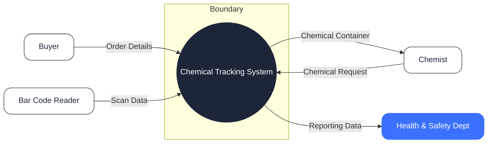
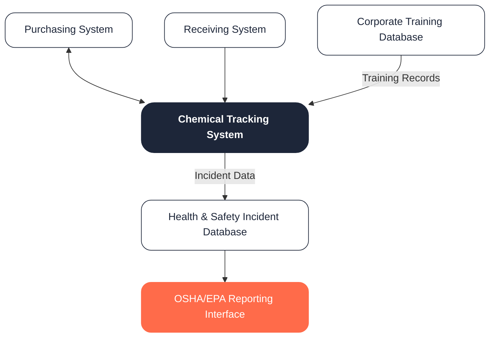
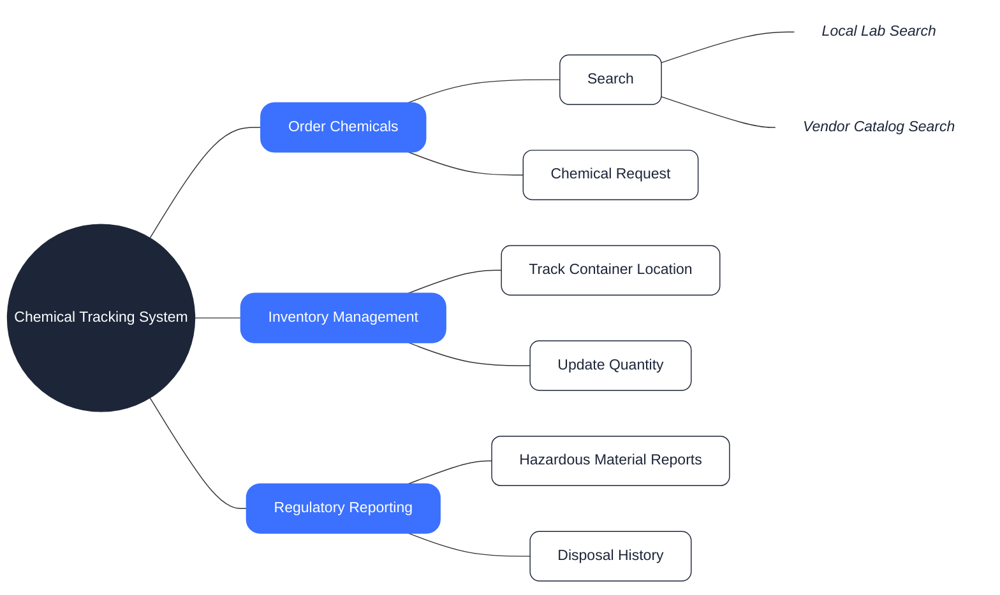
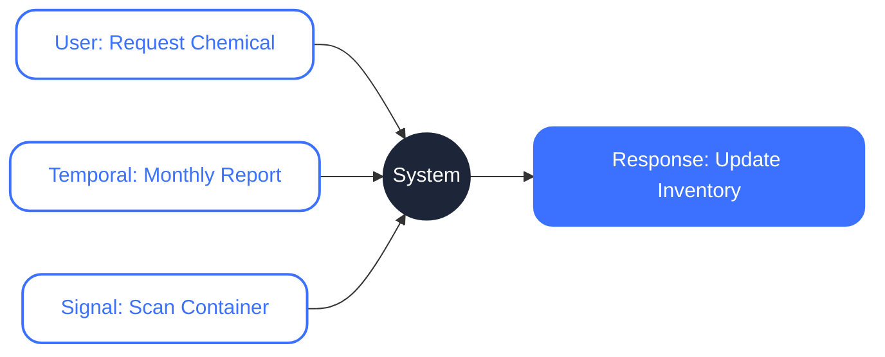

# Scope Representation Techniques

Visual models help define the boundary between what is inside the system and everything else in the universe. Use Mermaid syntax for quick illustrations styled for **Xray.tech**.

## 1. Context Diagram
**Purpose:** Illustrates the system's boundary and connections to external entities.



## 2. Ecosystem Map
**Purpose:** Shows all systems related to the system of interest, including indirect interactions.



## 3. Feature Tree (Pretty Tree Structure)
**Purpose:** A hierarchical depiction of product features.



## 4. Event List
**Purpose:** Identifies external triggers.



### Note on Rendering with Fonts
To render these diagrams with **Urbanist** and **Figtree** fonts using `mermaid-cli` (`mmdc`), provide a CSS file with the following `@import` and font-family rules:

```css
@import url('https://fonts.googleapis.com/css2?family=Urbanist:wght@400;700&family=Figtree:wght@400;700&display=swap');
text, .label, .nodeText { font-family: 'Figtree', sans-serif !important; }
.root text, h1, h2, h3, b { font-family: 'Urbanist', sans-serif !important; }
```

Render command: `mmdc -i input.mmd -o output.png -C diagrams/style.css`
