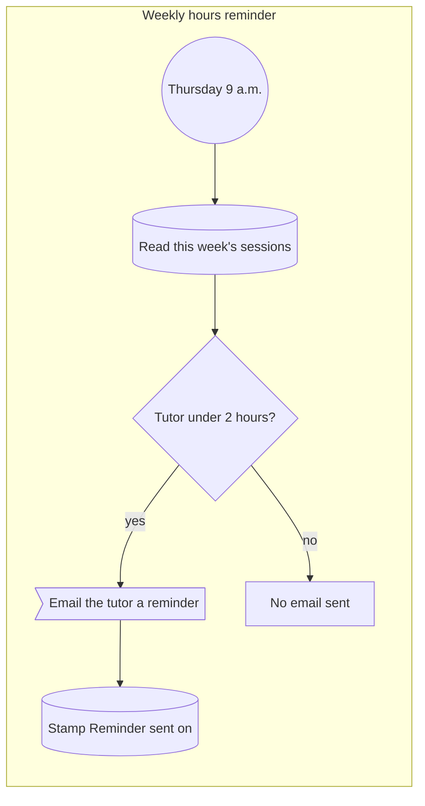

# client-doc-workflow-diagram: the client's products and deliverables as one workflow page

## Purpose in plain English

This skill helps you document a client's workflow with a readable diagram and a shareable explanation.

## How to explain the result

For a client-facing explanation, use ordinary words and the requested format. Explain unfamiliar abbreviations. Name what each number counts and explain its practical meaning. Keep internal identifiers out of the explanation. Keep necessary technical details in the working steps and technical references.

## Following the process

Use the process below. Preserve its conditions, commands, checks, and approval rules. Use information the user already supplied. Follow the existing questions or stopping rules when required information is missing.


Adapted from `blueprint-process-author` (XRAY-INC/THE-WORKSPACE-PRODUCT). Same Mermaid dialect and `%% atlas:` annotations, so the output still imports into Blueprint. The difference: this skill maps a client BUILD, built from what discovery and the canonical docs already say, and publishes the result as a web page the client can open.

## What you are producing

One web page per build that answers, at a glance: what does this client get from us, and how does each thing get made?

- **Products** are the systems the build creates: a base, an interface, an automation, a form, an integration.
- **Deliverables** are what a person receives because of them: a report, an email, a certificate, a dashboard view, a filed document.

The diagram follows each deliverable from its trigger, through the steps and systems that produce it, to the person who receives it. A reader should be able to point at any box and say who does it, which system it runs in, and what comes out.

The bar: could the client's operator read this page and explain to a new hire where each deliverable comes from? If not, the diagram is not finished.

## Where the output lands

- Web page source: `~/Claude-Work/CLIENTS/<CLIENT_FOLDER>/Documents/workflow-diagram/<build>/workflow-diagram.html`
- Mermaid source: `~/Claude-Work/CLIENTS/<CLIENT_FOLDER>/Documents/workflow-diagram/<build>/workflow-diagram.mmd`
- Published page: a shareable web link (see Step 6)

The web page is not one of the 8 canonical files, so `client-doc-push` does not push it. If Rachael wants the diagram in the client repo, put the Mermaid block in `prd.md` or `build-plan.md` (both allow inline Mermaid) through the matching skill.

## Step 1: Pin client and build

Same rule as the other `client-doc-*` skills. If the client or build isn't clear from context, ask ONE question that pins both.

## Step 2: Read the sources before asking anything

Read in this order. Mine them first; only ask about what they leave open.

1. **Discovery material**: the client repo's `projects/<build>/discovery-findings.md` (read with `gh api "repos/XRAY-INC/<CLIENT>/contents/projects/<build>/discovery-findings.md"`), plus discovery transcripts in `~/Claude-Work/CLIENTS/<CLIENT_FOLDER>/Transcripts/`.
2. **The canonical docs** for the build, from the client repo `projects/<build>/` or the local drafts in `Documents/<doc-type>/<build>/`:

| Doc | What the diagram takes from it |
|---|---|
| `vision-and-scope.md` | The products in scope. Non-goals stay off the diagram. |
| `prd.md` | The flow design and any diagram already drawn. |
| `build-plan.md` | Projects and outcomes, which usually map to one deliverable lane each. |
| `user-stories.md` | Who receives each deliverable and who does each human step. |
| `interface-prompts.md` | The interfaces people use to do or see the work. |
| `kpi-report.md` | Volumes per month (`runs=`) and what is measured at the end of each lane. |
| `decisions.md` | Branches and rules ("leave unmatched records unassigned"). |
| `changelog.md` | What is live today versus planned. |

If a canonical doc is a placeholder, say so in the gaps list (Step 4). Do not fill it in from guesses.

## Step 3: Draft the diagram

One lane per deliverable, grouped with `subgraph` so the page reads by deliverable. Start each lane with its trigger and end it with the person or system that receives the deliverable.



Shapes carry the step type (full list in `references/mermaid-dialect.md`):

| Shape | Use for |
|---|---|
| `((Circle))` | the trigger: a schedule, a form submission, a record change |
| `[/Slanted/]` | a form someone fills out |
| `[Rectangle]` | ordinary work, by a person or a system |
| `{Diamond}` | a decision; label every branch (`-->|yes|`) |
| `[(Cylinder)]` | a read or write in a system of record (Airtable, QuickBooks) |
| `[\Document\]` | a document produced or filed (PDF, report) |
| `>Flag]` | a message out: email, Slack post, SMS |
| `[[Double]]` | a process mapped in its own lane or its own diagram |

Rules for the draft:
- **Step names are verb phrases in plain English.** "Email the tutor a reminder", not "Reminder".
- **Name the real system inside the step** when it matters to the reader: "Write the invoice in QuickBooks Online". No field IDs or record IDs on the diagram.
- **Show the "does nothing" branch.** Clients ask "what if it doesn't apply?"
- **Mark what isn't live yet.** A step counts as live when `changelog.md` lists it or a debrief or transcript shows it running. Everything else gets the `planned` class (see Step 5) and "(planned)" at the end of its name.
- **Put quotes around any label with parentheses, brackets, or a colon**: `E3[\"Fill the report (planned)"\]`, `E4>"Send the report (planned)"]`. Unquoted, Mermaid fails to read the diagram.
- **3 to 15 steps per lane, under about 60 for the whole page.** If a lane runs longer, it is its own process: give it `[[Double]]` in the overview and its own diagram.
- **Before a build exists, map how the client works today.** Mark those steps with the `current` class and "Live, manual" in the deliverables table, not `planned`.

## Step 4: Annotate every step for Blueprint

Add one `%% atlas:` line per step, so the same source imports into XR Workspace Blueprint and prices the workflow:

```
%% atlas: D executor=system runs=40 minutes=0 note="Airtable automation, Thursdays"
```

- `executor=` is `human`, `system`, `ai_agent`, or `hybrid`. For an outside organization (a state agency, an auditor), use `human` and start the note with its name: `note="Outside: DSA review"`.
- `runs=` per month and `minutes=` per run, taken from `kpi-report.md` or the transcripts. For yearly or seasonal work (grant letters sent once a year, applications filed in rounds), use the monthly average (`runs=0.25` for 3 a year) and put the real pattern in the note: `note="3 a year, all in September"`.
- An estimate is fine; state it in the gaps list so the client can correct it. Never invent a number silently.

Then write a **gaps list**: every place the sources did not say who, how often, or what happens next. These become questions for the client and go into `running-updates-and-questions.md`, not onto the diagram as guesses.

## Step 5: Style it (XRAY brand)

Put these lines at the end of the Mermaid source. Blueprint ignores `classDef` and `class`, so styling never breaks the import.

```
classDef trigger fill:#1566b9,stroke:#0f4185,color:#fffaf0
classDef system fill:#fffaf0,stroke:#0e1c2d,color:#0e1c2d
classDef human fill:#e1ded8,stroke:#686f76,color:#0e1c2d
classDef deliverable fill:#0e1c2d,stroke:#0e1c2d,color:#fffaf0
classDef planned fill:#fffaf0,stroke:#868b8e,color:#686f76,stroke-dasharray:4 3
classDef current fill:#e1ded8,stroke:#0e1c2d,color:#0e1c2d,stroke-width:2px
```

Assign `trigger` to triggers, `deliverable` to the last step of each lane (what the person receives), `human` to steps a person does, `system` to the rest, and `planned` to anything not live yet.

Never write a comment line that is only `%%`; it breaks rendering everywhere. Use `%% ---` instead.

## Step 6: Build and publish the web page

Use `references/page-template.html`. Fill in:
1. Page title: `<Client name> Workflow Map` (two to four words, no subtitle).
2. One sentence under the title: what the build does for the client.
3. The Mermaid source inside `<pre class="mermaid">`.
4. The deliverables table: one row per lane with deliverable, who receives it, how often, which system produces it, live or planned.
5. The gaps list as "Questions for <client>".
6. The date and the build name in the footer.

The template has no Mermaid library, because published pages render Mermaid on their own. Opened straight from disk, that file shows the diagram source as text, so never hand it over as a file on its own. Whenever the page leaves the published link (a doc set, an email, a Slack upload), also produce the disk-openable versions in the same folder:

1. Render the picture: `mmdc -i workflow-diagram.mmd -o workflow-diagram.svg -b '#ffffff'`, and a `.png` the same way with `-w 2600`.
2. Write the handover copy of the page by replacing its `<pre class="mermaid">` block with the rendered SVG inline (strip the SVG's fixed width and height and give it `width:100%`), and wrap the file in a doctype, html, head, and body so it opens correctly from disk.
3. Open the handover copy once and confirm the picture shows before giving anyone the file.

The publishable original keeps the bare Mermaid block; only the handover copy embeds the SVG.

Publish it:
- **Claude Code:** save the file to the path above, then publish it with the Artifact tool (load the `artifact-design` skill or run the Artifact quickstart first). Mermaid renders natively in published pages, so no library is needed.
- **claude.ai or Claude Desktop:** create an HTML artifact from the same filled template.

Give Rachael the link. The page is private until she shares it from the page's Share menu; say so.

## Step 7: Hand off the Blueprint import (optional)

If Rachael wants the workflow priced in XR Workspace, tell her: Blueprint, then **Add steps from text**, then **Paste Mermaid**, paste the `.mmd` contents, **Read diagram**, review, **Apply**. Pick the tab first; the import lands in the tab that is open.

## Check before you publish

- Every in-scope product from `vision-and-scope.md` appears; no non-goal does.
- Every lane ends in a deliverable someone receives.
- Every decision has labelled branches, including the "no" branch.
- Every step has an `%% atlas:` line with `runs` and `minutes`, or appears in the gaps list.
- Planned steps are marked planned.
- No field IDs, record IDs, or jargon on the page. Plain English per `~/Claude-Work/ABOUT-ME/my-voice.md`; no metaphors, no em dashes in prose.

## References

- `references/example-workflow-diagram.md`: a finished diagram, deliverables table, and gaps list for a made-up client. Read it before drafting.
- `references/mermaid-dialect.md`: the full Mermaid subset Blueprint accepts (shapes, 26 step types, annotation grammar, limits). Read it when a diagram fails to import.
- `references/page-template.html`: the web page template.

## When this skill is the wrong answer

- Mapping a client's internal business process that isn't part of a build → `blueprint-process-author` in XR Workspace
- A step-by-step explainer of one automation → `how-it-works-doc` or `automation-explainer-local`
- A full shareable write-up of what was built in a session → `build-page-publisher-local`
