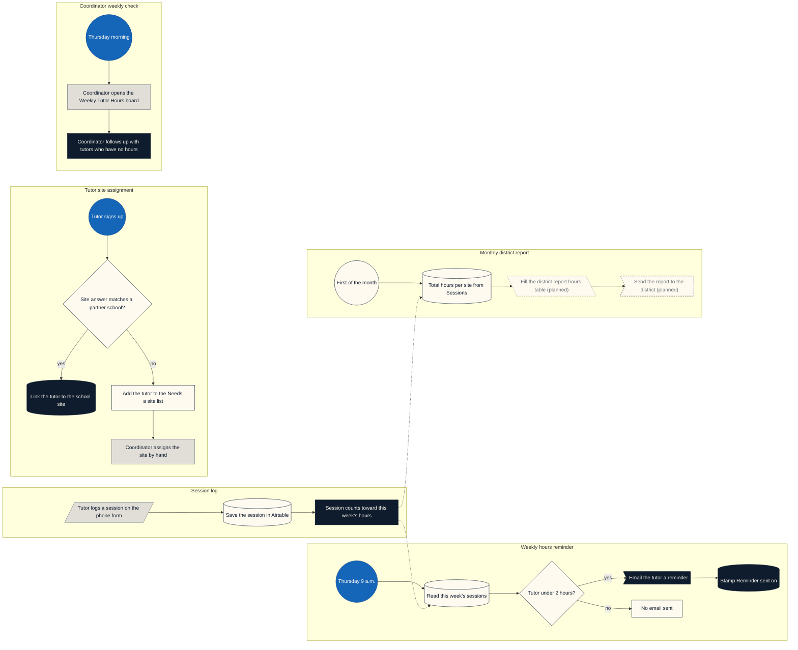
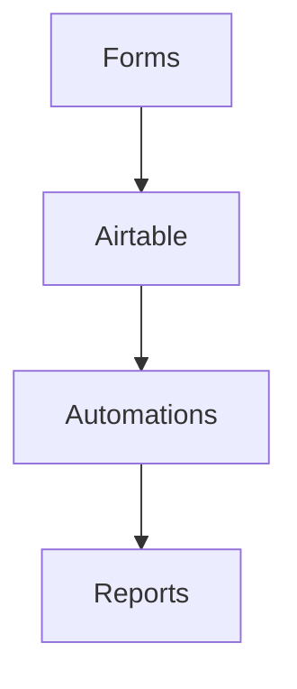

# Example: a finished workflow diagram

The client is made up (Riverside Literacy Project, repo `XRAY-INC/RIVERSIDE-LITERACY`, build `2026-09-build`). It matches the example docs in the other `client-doc-*` skills, so you can see how each canonical doc feeds the diagram.

Where each part came from:
- Lanes: the 5 in-scope items in `vision-and-scope.md`
- Who receives each deliverable: the personas in `user-stories.md`
- Branch rules: `decisions.md` (leave unmatched tutors unassigned; remind on Thursdays)
- Live versus planned: `changelog.md` (the district report is not shipped yet)
- Volumes: estimates from the discovery transcript, flagged in the gaps list

---

## Mermaid source (`workflow-diagram.mmd`)

## Deliverables table

| Deliverable | Who receives it | How often | Produced by | Status |
|---|---|---|---|---|
| A saved session record | Program coordinator | About 300 a month | Fillout form into Airtable | Live |
| Tutor linked to their school | Program coordinator, site principal | About 15 a month | Airtable automation | Live |
| Reminder email | Volunteer tutors under 2 hours | About 40 a month | Airtable automation | Live |
| Weekly follow-up list | Program coordinator | Weekly | Weekly Tutor Hours board | Live |
| District hours report | The school district | Monthly | Airtable, then the coordinator sends it | Planned |

## Questions for Riverside Literacy Project

1. About how many tutoring sessions are logged in a typical month? The diagram uses 300 as an estimate.
2. About how many new tutors sign up each month? The diagram uses 15.
3. Who sends the district report once it's filled in: the coordinator, or should it go automatically?

---

What a weak diagram looks like, and why it fails:

The boxes are systems, not steps, so nobody can tell what happens or who receives anything. There are no decisions, no triggers, and no way to tell live work from planned work.
