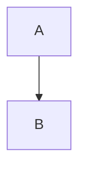
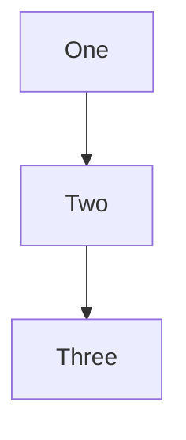
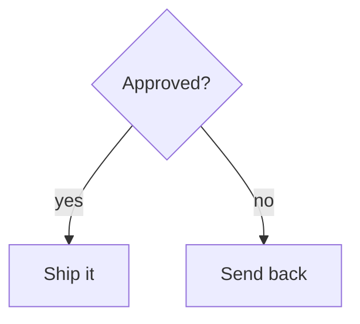
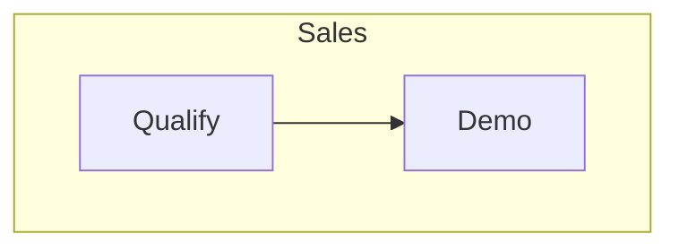

# The Mermaid dialect the Blueprint importer accepts

Everything here is ordinary Mermaid, a diagram written to this reference still
renders unchanged in GitHub, Notion, Obsidian and mermaid.live. The importer
reads a subset and ignores the rest, and this document is the exact subset.

Source of truth: `src/lib/blueprint/mermaid.ts`, tested in
`src/__tests__/lib/blueprint-mermaid.test.ts`.

## Contents

1. [Header and diagram type](#1-header-and-diagram-type)
2. [Node shapes → step types](#2-node-shapes--step-types)
3. [The full step-type vocabulary](#3-the-full-step-type-vocabulary)
4. [Connections](#4-connections)
5. [The `%% atlas:` annotation grammar](#5-the--atlas-annotation-grammar)
6. [Subgraphs](#6-subgraphs)
7. [What is ignored](#7-what-is-ignored)
8. [Limits](#8-limits)
9. [Troubleshooting import failures](#9-troubleshooting-import-failures)

---

## 1. Header and diagram type

```
flowchart TD
```

`flowchart` or `graph`, any direction (`TD`, `TB`, `LR`, `RL`, `BT`). The
direction does not affect the import, Atlas lays steps out by dependency depth,
left to right, regardless.

**Only flowcharts import.** `sequenceDiagram`, `classDiagram`, `stateDiagram`,
`erDiagram`, `gantt`, `pie` and `journey` are refused by name rather than
half-parsed, because a sequence diagram's semantics are not a process graph's
and quietly importing it would produce nonsense.

A missing header still parses (with a warning), pasting a bare body works.
A ` ```mermaid ` fence pasted along with the diagram is stripped automatically.

## 2. Node shapes → step types

| Mermaid        | Step type      | Reach for it when                      |
| -------------- | -------------- | -------------------------------------- |
| `A[Label]`     | `task`         | ordinary work, the default            |
| `A(Label)`     | `task`         | same; use whichever reads better       |
| `A([Label])`   | `task`         | same                                   |
| `A{Label}`     | `conditional`  | a decision with branches               |
| `A{{Label}}`   | `conditional`  | same                                   |
| `A[(Label)]`   | `database`     | a system-of-record read or write       |
| `A[[Label]]`   | `subprocess`   | a process of its own, mapped elsewhere |
| `A[/Label/]`   | `form`         | intake, a submitted form               |
| `A[\Label\]`   | `document`     | a document produced or filed           |
| `A((Label))`   | `signal`       | a trigger or event                     |
| `A(((Label)))` | `signal`       | same                                   |
| `A>Label]`     | `notification` | an alert, a ping, an email out         |

Anything unrecognised falls through to `task` rather than guessing.

**Labels.** Quotes are stripped (`A["Two words"]` → `Two words`). `<br>` and
`<br/>` fold to spaces so markup never leaks into a step name. Names are capped
at 200 characters.

**Refs.** The identifier before the shape (`A`, `step1`, `qualify_lead`) is
payload-local, it exists only to connect the steps within this one diagram and
is never stored. Use whatever is readable; short is fine.

A ref used in a connection but never declared with a shape still becomes a
step, named after the ref:



gives two steps called `A` and `B`. Fine for a sketch, not for a finished
blueprint.

## 3. The full step-type vocabulary

Set explicitly with `type=` when the shape cannot express it:

`audio` · `chat` · `database` · `delay` · `delegate` · `document` · `email` ·
`form` · `link` · `meeting` · `notification` · `payment` · `phone` ·
`research` · `sequence` · `signal` · `sms` · `tag` · `task` · `video` ·
`webpage` · `workflow` · `alias` · `conditional` · `goto` · `subprocess`

Ones worth knowing because no shape implies them:

- `meeting` - a call, a standup, a review
- `payment` - money moving
- `delay` - a deliberate wait ("48 hours before follow-up")
- `delegate` - handing work to someone else as the step itself
- `research` - investigation with no fixed output
- `sequence` - an automated multi-touch sequence (nurture, drip)
- `workflow` - an automation run as one step

An unknown `type=` warns and leaves the shape's default in place, rather than
failing the import.

## 4. Connections

Every arrow form means the same thing to Atlas, a `sequence` edge. Mermaid's
dotted/thick variants are presentation, and inventing a semantic difference from
them would be a guess the author never made.

Accepted: `-->` `---` `-.->` `==>` `===` `-.-` `~~~` `--o` `--x` `<-->`

Chains split into one connection per arrow:



→ two connections.

**Branch labels**: both forms work, and the label is read but not currently
stored on the edge:



Label your branches anyway. They are the difference between a readable decision
and a fork with no explanation, and they will be preserved when edge metadata
lands.

**Self-connections are dropped.** `A --> A` produces no edge, a step that
follows itself is almost always a typo, and modelling a genuine retry is better
done with an explicit rework step.

## 5. The `%% atlas:` annotation grammar

```
%% atlas: <ref> key=value key=value …
```

One line per step, anywhere in the file, before or after the node is declared,
since annotations are applied in a second pass.

| Key                                           | Value                                      |
| --------------------------------------------- | ------------------------------------------ |
| `executor`                                    | `human` · `system` · `ai_agent` · `hybrid` |
| `runs` (aliases: `frequency`, `runsPerMonth`) | a non-negative number, per month           |
| `minutes` (alias: `minutesPerRun`)            | a non-negative number, per run             |
| `type` (alias: `stepType`)                    | any step type from §3                      |
| `note` (alias: `description`)                 | free text; quote it if it contains spaces  |

```
%% atlas: B executor=ai_agent runs=420 minutes=2 note="Clearbit plus the scoring rubric"
```

**Errors are per-token, not per-file.** An unknown key, an out-of-vocabulary
executor, or a ref that matches no step produces a warning shown next to the
import diff, the rest of the line and the rest of the diagram still import. A
typo in one annotation should not cost someone the whole diagram.

Keys are case-insensitive. A comment that is not `%% atlas: …` is ignored
entirely, so ordinary Mermaid comments are safe.

**Never write a comment line that is only `%%`.** Mermaid strips comments with a
rule that requires at least one character after the marker, so a bare `%%`
survives the strip and is concatenated onto the line below it. Above the
`flowchart` header that hands the grammar `%%%%%%flowchart TD`, and the diagram
renders nowhere, not GitHub, not Notion, not Mermaid Live, while importing
here perfectly, because this importer drops every comment line regardless. Use a
rule with content instead:

```
%% Inbound lead intake
%% ---
%% Annotated for the cost rollup.

flowchart TD
```

The importer warns when it sees one above the header. Below the header it is
harmless, and it does not warn.

## 6. Subgraphs



Subgraphs parse: the steps inside import, the connections import, and the
subgraph title is not mistaken for a step. **The grouping itself is not
imported**, the importer warns that steps arrived flat.

This is a genuine limitation rather than an oversight: Atlas sections belong to
a tab and are created through their own route, and inventing them from a
subgraph title would guess at structure the author did not confirm. Create
sections on the canvas afterwards and assign steps to them there.

Use subgraphs anyway if they make the diagram readable for humans, nothing is
lost but the grouping.

## 7. What is ignored

Silently, so a styled diagram imports cleanly:

- `classDef`, `class`, `style`, `linkStyle` - presentation
- `click` - interaction
- `direction` inside a subgraph
- trailing semicolons
- ` ``` ` / ` ```mermaid ` fences
- CRLF line endings
- ordinary `%%` comments

## 8. Limits

| Limit                            | Value         | What happens                                    |
| -------------------------------- | ------------- | ----------------------------------------------- |
| Source length                    | 100,000 chars | refused up front                                |
| Operations (steps + connections) | 500           | refused, with a suggestion to split across tabs |
| Step name                        | 200 chars     | truncated                                       |
| Ref                              | 64 chars      | truncated                                       |
| Note                             | 4,000 chars   | truncated                                       |

## 9. Troubleshooting import failures

**"Only Mermaid flowcharts map onto a process graph"**: the diagram is another
Mermaid type. Convert it: a sequence diagram's participants are usually
executors, and its messages are usually steps.

**"No steps found, is this an empty flowchart?"**: a header with no body, or
every line was a comment or a style directive.

**A step appeared with a strange name like `J>Notify me`**, a shape's opener
was not recognised, so the whole fragment became the name. Check the brackets
balance.

**Steps imported but connections did not**: the arrows are probably inside a
label, or the refs on either side do not match the declared ones. Refs are
case-sensitive: `A` and `a` are two different steps.

**A step has no workload in the rollup**: its `%% atlas:` line is missing, or
its ref does not match the node's. The import warns about the second case.

**Everything landed in the wrong place**: the import targets the tab that was
selected when the dialog opened. Pick the tab first.
