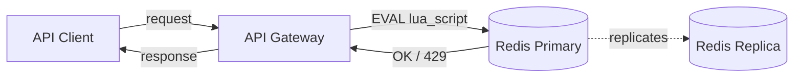

# Example PRD: fully-worked output

A canonical end-to-end PRD using the rate-limiter case from Rachael's slide deck. This is the reference output the skill should aim to match in shape, compression, and discipline. Use as a sanity check: if your draft doesn't look like this in form, fix the form first.

---

# PRD: Per-User API Rate Limiter
**Client:** Internal example · **Date:** 2026-06-02 · **Mode:** interview

## Outcome
Every API caller gets a fair share of capacity, and one misbehaving caller can't take the API down for everyone else.

## Frame + Estimate

```
Given     50k rps peak · 2M users · cap 100 req/min/user · p99 budget < 5 ms
Non-goal  global exactness across regions - approximate is fine, say so up front
State     2M × ~30 B/bucket ≈ 60 MB → fits one Redis node's RAM, trivially
Ops       50k rps × 1 atomic op = 50k ops/s → under one primary (~100k+ ops/s)
Hop       +1 round trip intra-AZ ≈ 0.2 ms → inside the 5 ms budget
Verdict   centralized Redis works to ~100k rps; the ceilings are primary ops/s and the per-call hop
```

*Latency numbers per Colin Scott interactive (2020 calibration), https://colin-scott.github.io/personal_website/research/interactive_latency.html*

**Assumptions:**
- Single primary region; cross-region replication is out of scope
- All callers identified by an API key we already issue
- Redis Sentinel for failover is acceptable infrastructure cost

## Design: Token bucket, refilled lazily, mutated atomically.

**Why Lua:** check-refill-decrement must be **one round trip**, or two concurrent requests both read N and both pass. **Atomicity on the node** closes the race, and refill uses the **node's clock**, so no client skew.



## Defend: Token bucket, and here's what it beat.

| Algorithm | Accuracy | Memory / Key | Boundary Burst | Cost |
|---|---|---|---|---|
| Fixed window | low | O(1) | up to 2× | trivial |
| Sliding window log | exact | O(req) | none | heavy |
| Sliding window counter | good | O(1) | minor | moderate |
| **Token bucket ✓** | good | O(1) | smooth, tunable | atomic refill |

**Ruled out:** Fixed window leaks at the boundary (2× allowed traffic for a single client). Sliding window log is exact but O(req) memory per key, at 2M users this is infeasible. Sliding window counter is close, but smoothness matters more for our SLA.
**Reversibility:** Two-way door, if token bucket proves insufficient we can swap to sliding window counter without rewriting the gateway contract. Stays cheap to revisit.

## Failure: what breaks, and who it takes with it.

| Failure mode | Mitigation |
|---|---|
| **Redis is a SPOF** | Replica + Sentinel for failover. The limiter must never be the reason the API is down. |
| **Partition → fail open** | Fall back to a local in-process bucket. Bounded over-admission beats a global outage on a soft control. Per-route flag. |
| **Blast radius contained** | 5 ms timeout + circuit breaker on the Redis call. Limiter degrades; requests still flow. |
| **Hot tenant + clock** | One abusive key won't shard; pre-check locally and approximate at the extreme. Refill clock is the node's, not callers'. |

> **The limiter must never be the reason the API is down.** Every failure mode above resolves to this contract.

## Evolve: where this grows

- **v2:** Per-route limits (read endpoints get a separate bucket from write endpoints).
- **v3:** Tiered limits (paying tenants get higher caps, configured at the bucket key).
- **10x trigger:** If peak crosses ~80k rps sustained, shard the primary by key range. Until then, one primary is the right answer.

---

## Reading notes: what makes this output "right"

If you're grading your own output against this example, check:

1. **Outcome sentence appears before any number**: not buried below the block.
2. **Six rows in order**.`Given · Non-goal · State · Ops · Hop · Verdict`. No reorder.
3. **Each estimate row resolves to → `<fits where?>`**, that's the falsifiability check.
4. **Verdict names exactly two ceilings.** Three is sloppy; one is the No-blast-radius trap.
5. **Design title is verb-first, no hedging, ≤ 65 characters.** "Token bucket, refilled lazily, mutated atomically." (51 chars) passes; "Daily poll, template-fill, draft to Adobe Sign, webhook closes." (64 chars) also passes; "We propose a token bucket approach" fails (hedged).
6. **Why-paragraph bolds the load-bearing keywords.** `one round trip`, `Atomicity on the node`, `node's clock` - change any of those and the design breaks.
7. **Defend matrix has exactly one row highlighted ✓** + a "Ruled out" line + reversibility annotation.
8. **Failure cards are 2×2 minimum** with risk + mitigation in the same card. The load-bearing contract gets quoted in a `>` blockquote after the grid.
9. **Latency citation is year-stamped.** "2020 calibration" lets a reviewer grade the input.
10. **Numbers are round.** `~30 B/bucket`, `≈ 60 MB`, `~100k+ ops/s`. Not `60.4 MB` or `97,832 ops/s`.

If any of these miss, the output isn't done.
