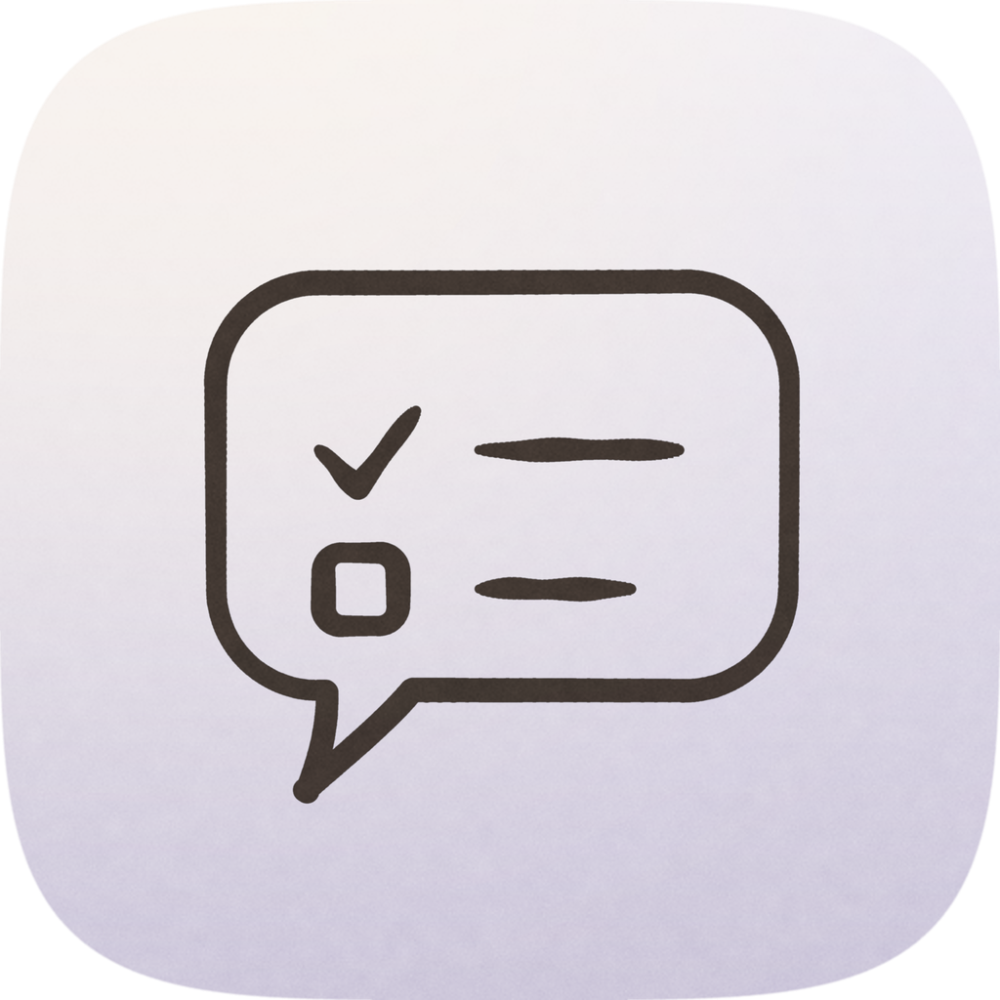

# ADHD Task Helper

ADHD Task Helper is a plugin that makes replies easier to follow and helps you start tasks, sort a brain dump, and resume interrupted work.
It turns what you share into a manageable next action, practical help, or a restart note, with the level of detail you prefer.

## Skills

- **I Have ADHD:** Adapt communication when ADHD-friendly replies are requested.
- **Get Unstuck:** Find a workable start and produce useful drafts or other practical help.
- **Sort My Brain Dump:** Choose a starting point while preserving deferred notes and tasks.
- **Pick It Back Up:** Resume from available context or a checkpoint you provide.

## Use

Open [ADHD Task Helper](https://chatgpt.com/plugins/plugins_6acf1fe78fd08191a361b2a74e1fe768) in the creator's account. This plugin is currently private.

Example requests:

- "I am stuck starting a task. Help me find a manageable first action."
- "Help me sort this brain dump and choose what to do first."
- "Help me pick up interrupted work using this checkpoint."

## Source and verification

Version 0.1.3. The repository contains the portable plugin manifest, four skills, their supporting references and UI metadata, and the Soft Index icon.

Package validation and a separate-agent instruction dry run have been completed. Installed-host routing and real-user usefulness have not yet been tested. The plugin uses available conversation context; it does not provide automatic cross-chat memory or its own scheduling service.

The icon depicts conversational help with completing tasks. It was made using the Ghibli Icon Maker's Soft Index renderer and checked at 1024 pixels and 64 pixels.

Supporting research sources are linked from `skills/i-have-adhd/references/design-notes.md`.
