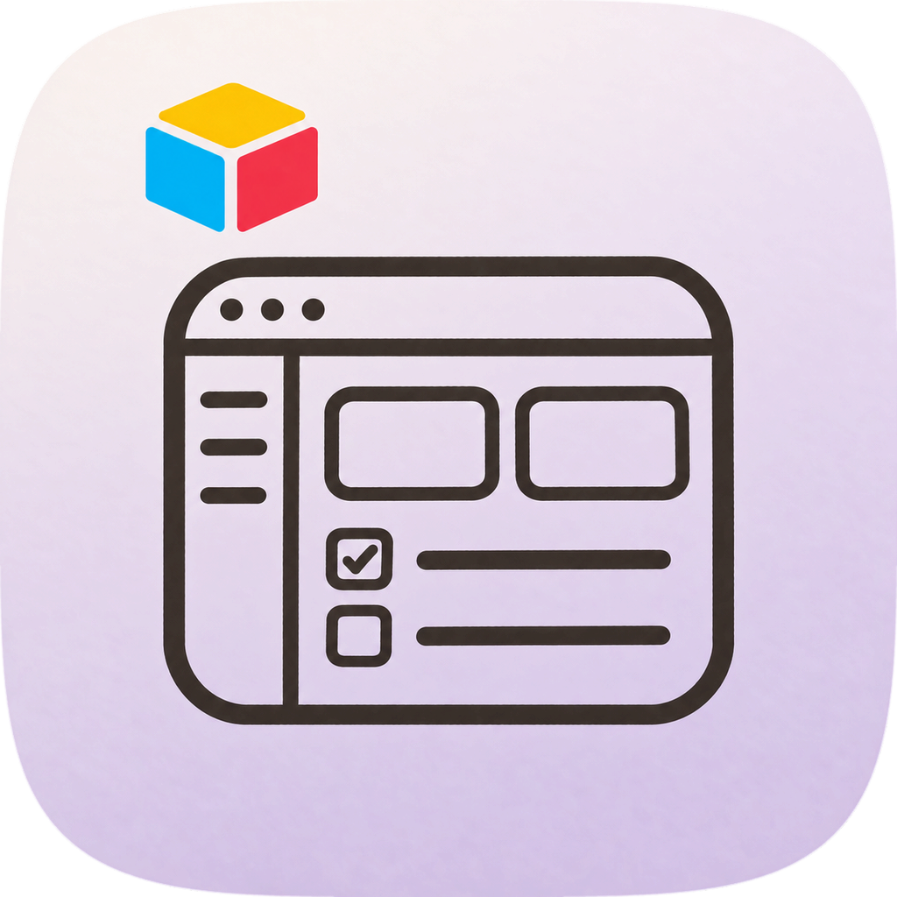

# Airtable Interface Builder

*Make everyday work feel good.*



Turn a cluttered Airtable interface into a clear, playful place to get work done. Keep the style your users love while connecting the right people, tasks, documents and dates.

- Refine the existing design and preserve earlier source versions.
- Build clear task, document, training and calendar interactions.
- Check ownership, linked records, saved feedback and reversible actions.
- Test useful behaviors, mobile layouts and the actual Airtable setup.
- Return complete source and distinguish local checks from live results.

The stable plugin and skill identifier is `airtable-interface-craft`. The marketplace is `airtable-interface-builder`. The release version is `1.0.1`.

## Install in Claude Code

Run these commands in a terminal with Claude Code installed:

```sh
claude plugin marketplace add RachaelQuisel/airtable-interface-builder
claude plugin install airtable-interface-craft@airtable-interface-builder
```

Start a new Claude Code session if the skill is not yet visible. Invoke it with:

```text
/airtable-interface-craft:airtable-interface-craft
```

Then share the source or accessible interface, your requested changes and the finish you want: source only, installed, published or a verified record action.

## Use in Codex

After installing the Codex plugin, use this prompt:

`Use $airtable-interface-craft to refine this Airtable interface and verify its real behavior.`

The package includes portable and Codex compatibility manifests alongside its Claude Code manifest.

## Connections and limits

Enable the Airtable connector, browser tools and local build tools you want the assistant to use in your host. This plugin supplies instructions and an offline helper. It bundles no authentication, MCP server, hooks or hosted service and grants no account permissions.

Without connected tools, it can work from supplied source and schema. Live inspection, source return, publication and record verification require the relevant access and your authorization. SDK capabilities and Airtable permissions determine which interactions can be built. A local test does not prove a live save or file upload.

## Trigger

Ask to build/refine a connected custom Airtable interface or to return revised source to Airtable.

## Inputs

Your source, feedback, actual SDK, current data relationships, permission settings and intended finish: source only, installed, published or verified record action.

## What happens

The assistant preserves the style and versions you value, checks the data model, builds focused pieces, tests meaningful behaviors and examines the real interface settings. Complete source is returned and read back when installation is authorized. Publication and live saves remain distinct, verified steps.

## Outputs

The requested interface/source, focused verification evidence and a short handoff that says what is saved, installed, published or still untested.

## Contents

- One discoverable skill, with guidance loaded only for the current part of the work.
- Design/data, reliable-interaction and verification/return references.
- A GoL case study separating transferable methods from client-specific rules.
- A read-only Python helper for exact source/readback comparison.
- [Naming and listing copy](LISTING.md), with the recommended name and alternatives.

## Data and rights

The assistant may read source files, schema, records and browser content needed for your request. It may save files or use connected services within the scope you authorize. The offline helper reads supplied local files and reports their paths, sizes and hashes; it makes no network requests or writes. See [Data handling](PRIVACY.md) for the complete disclosure.

The canonical source is the [Airtable Interface Builder repository](https://github.com/RachaelQuisel/airtable-interface-builder). Report problems in its [issue tracker](https://github.com/RachaelQuisel/airtable-interface-builder/issues).

All rights reserved. Reuse requires permission under [LICENSE](LICENSE). Airtable names and the identifying mark belong to their respective rights holders; this independent plugin is not endorsed by Airtable. See [Third-party notices](THIRD_PARTY_NOTICES.md).
