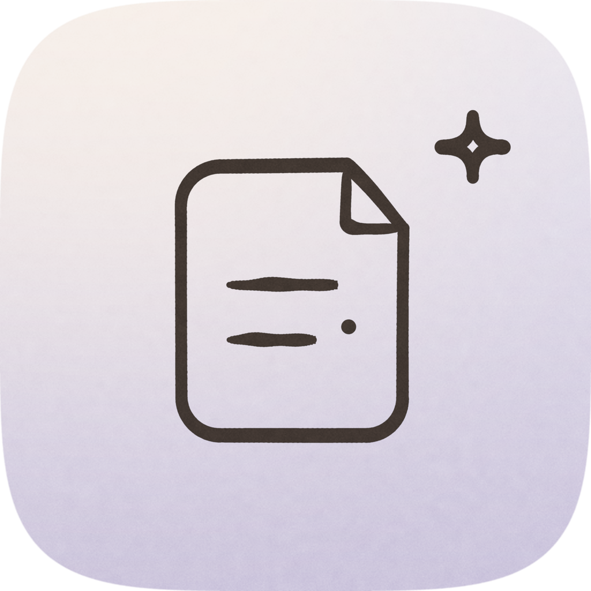

# Cited Research Assistant

I built this plugin to show gaps in the evidence. It finds sources and retrieves passages. It links each supported claim to a retrieved passage. It declines details that the available material cannot verify.

## Setup and invocation

- Supported host: Claude Code 2.1.288+, Python 3.10+, native WebSearch and WebFetch.
- Install by name from this repository. From a checkout, run `claude plugin marketplace add ./` and then `claude plugin install cited-research-assistant@cited-research-assistant`. From GitHub, run `claude plugin marketplace add RachaelQuisel/cited-research-assistant` and then the same install command.
- Load this checkout without installing with `claude --plugin-dir .`, then invoke `/cited-research-assistant:cited-research-assistant` with a question, date range, or selected draft.
- Chat and cloud Cowork do not provide this release's verified final-response hook workflow.
- arXiv's public API requires no key. Its range uses submission date; retain paper versions and separate publication dates.
- Semantic Scholar's domain-restricted web search finds candidates. The optional API uses unauthenticated requests; it reads no stored API credential. Calls can return 429 and site fetches can return 403. Those are reported as unavailable evidence.
- If no passage can be retrieved, the plugin says “I can't verify this.” Search snippets and a valid-looking reference cannot substitute for support.

## Workflow

Research produces atomic claim records, source records, a cited Markdown brief, references, and unresolved claims. A draft audit separately checks citation existence and whether the retrieved source supports the stated claim. Abstract-only sources and preprints remain labeled; inference and source disagreement stay explicit.

For a fictional example, if a supplied abstract reports a sample of 12 but omits allocation, the brief cites the sample statement and declines a claim about randomization. The plugin never treats this example as a real paper. See the skill's record-format guide.

The final-response hook compares Claude's actual final text with the brief rendered from checked records. It requests a correction for additions, records failures, and stops an unresolved check as incomplete. This is structural coverage. Claude or the user still reviews semantic support; no universal accuracy guarantee is claimed.

## Data handling

Queries and selected draft claims go to Claude's native search/fetch tools and the chosen public academic provider. API calls send the query and date range to arXiv or Semantic Scholar. This release reads or sends no API credential.

Source records, passages, and actual final-message audits persist under `~/.local/share/cite-or-decline/`, outside the plugin folder. They remain until the user removes them, including after plugin updates or uninstall. Export files stay where the user selects. Distributed files contain instructions and fictional examples, not user research records.

## Development and license

Run `claude plugin validate .claude-plugin/plugin.json`, `claude plugin validate .claude-plugin/marketplace.json`, and `python3 -m unittest discover -s tests`.

The original code and instructions are MIT licensed. Source passages and user material keep their own rights; use short supporting excerpts with attribution.
