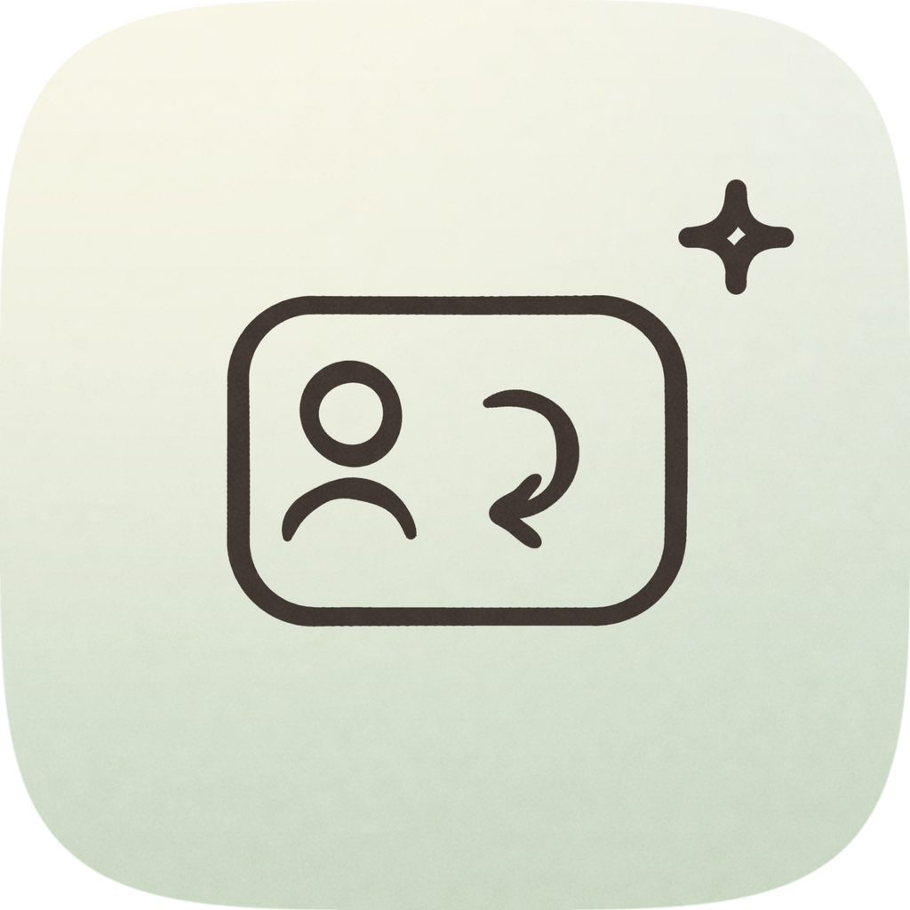

# Contact Follow-Up Tracker

Save contacts, encounters, and confirmed promises in a Google Drive log. Each update creates a new version. Ask who you promised what. Get a contact briefing before your next conversation. Record completed or cancelled commitments and changed dates. Keep the prior history. Enable Cowork tasks to check the current log for upcoming or overdue commitments.

## Setup and use

Use Cowork with its connected Google Drive connector and Python 3.10+. Upload this plugin ZIP through Customize > Plugins > Add > Upload plugin. You can also install the plugin by name from this repository: `claude plugin marketplace add RachaelQuisel/contact-follow-up-tracker`, then `claude plugin install contact-follow-up-tracker@contact-follow-up-tracker`. From a local checkout, add the marketplace with `claude plugin marketplace add ./` and use the same install command. Ask Claude to use Contact Follow-Up Tracker and supply your chosen Drive folder URL and log ID. Put those two values in your Cowork project instructions to reuse them in a fresh session. One folder holds one log. This package bundles no credential or external backend.

A fictional example: create separate contacts for Alex Fixture, the designer, and Alex Fixture, the founder. Record “We might exchange ideas sometime” as an encounter note, with no inferred promise or date. Explicitly record a promise only after choosing the intended contact. Ask “Who did I promise what?” or “Brief me on alex-designer,” then explicitly reschedule or mark a commitment completed. Completion is user-reported, not proof of delivery.

## Storage and data flow

Durable JSON snapshots live in the selected Drive folder, outside the distributed plugin. Cowork reads selected notes and connector records; its connector creates new snapshots. Prior versions remain, including their source wording and history, until the user removes them in Drive. Session work files are temporary. The helper has no network calls and does not read credentials.

Check the folder and each new file's actual permissions. A Restricted folder did not prevent domain reader access on new child files in the fixture. Choose your intended sharing and verify a blank file before storing real contacts. Installation does not enable reminders or send anyone messages. The primary host is Cowork with Drive; chat and Claude Code connector workflows have not been verified.

## Reminder setup and receipt limits

Explicitly choose a cadence, lead time, and timezone, save the log settings, and configure a Cowork scheduled task with the stable folder ID and log ID. Remote tasks read the live snapshot chain. Open dated commitments are eligible; undated, completed, cancelled, or disabled reminders produce no nudge. No actionable change means no completion notification. A failed read is a failed check, never a successful empty scan.

Cowork's tested tools expose task status but no completed-output or delivery receipt. After you see a reminder, explicitly acknowledge its token and task/run reference to save a `user_acknowledged_output` receipt. That suppresses unchanged commitments; changed dates or actions can surface again. Before acknowledgement is saved, reminders may repeat. Task success alone does not update receipt history, and this package does not guarantee automatic once-only push/email delivery.

Validate the plugin with `claude plugin validate .claude-plugin/plugin.json` and the marketplace with `claude plugin validate .`. Run checks with `python3 -m unittest discover -s tests`. Source and original icon composition are MIT licensed. Provider and Claude services retain their own terms.
